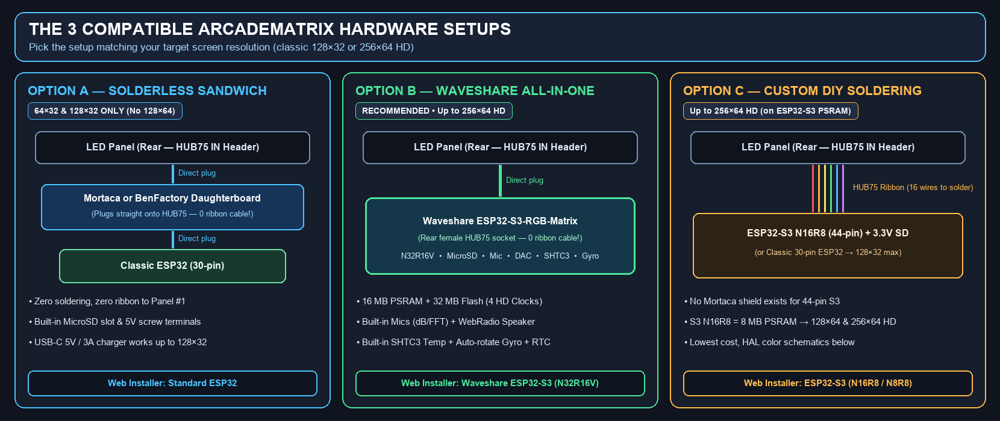
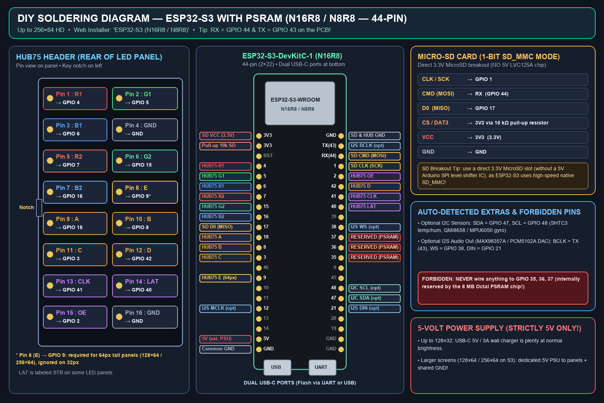
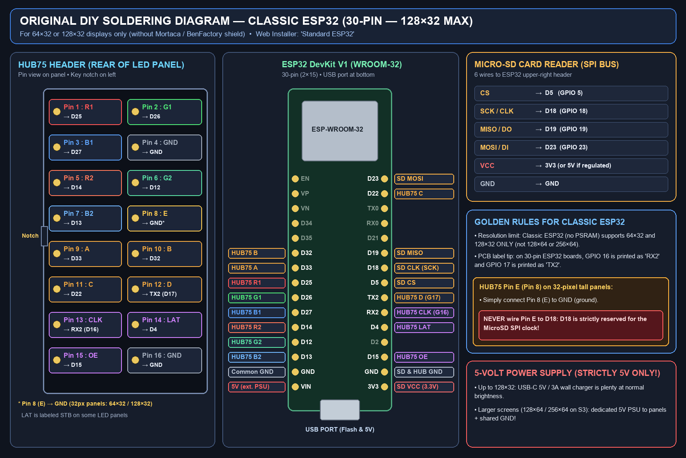
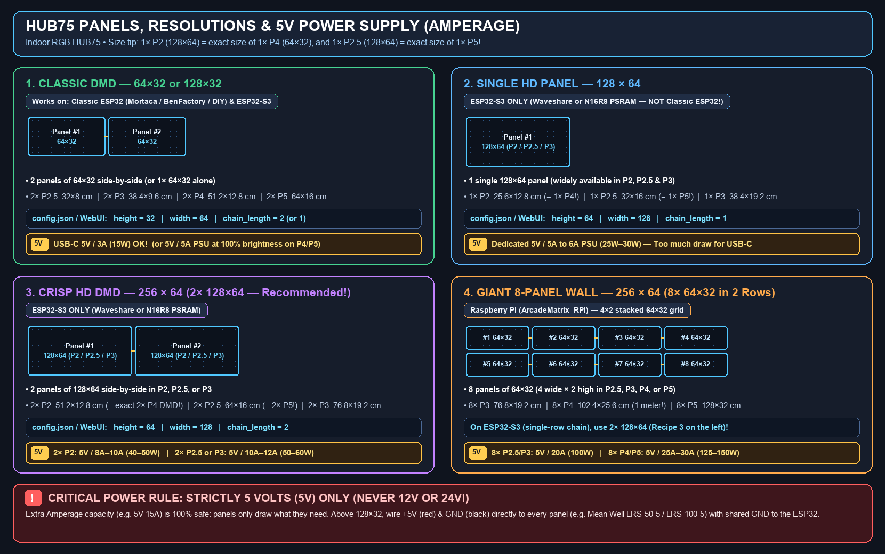

# Beginner's Guide: Hardware, Wiring, Panels & Power Sizing

🇬🇧 English | 🇫🇷 [Français](BEGINNER_GUIDE_FR.md) | 🇪🇸 [Español](BEGINNER_GUIDE_ES.md)

This short, jargon-free guide goes straight to the essentials: picking the right controller board, choosing your **`HUB75`** panels, sizing your **`5V`** power supply (Amperage), and starting **ArcadeMatrix** in minutes.

---

## 1. How ArcadeMatrix Works (In 4 Quick Steps)

Your display is **100% standalone** (no computer needs to stay connected):
1. **Prepare a `FAT32` MicroSD card**: extract **[`ArcadeMatrix-sdcard.zip`](https://github.com/red77290/ArcadeMatrix/releases/latest)** directly to the root of the SD card, then **open `config.json` in Notepad / TextEdit and enter your `2.4 GHz` Wi-Fi `ssid` and `password`** *(mandatory: Wi-Fi cannot be configured from the LED screen itself!)*.
2. **Flash the board in 1 click (one time only)**: plug the ESP32 into your PC/Mac via USB, open **[red77290.github.io/ArcadeMatrix](https://red77290.github.io/ArcadeMatrix/)** in Chrome or Edge, and click **Install**.
3. **Plug the board onto the LED panel & power with `5V`**: on boot, the DMD connects to your Wi-Fi and displays its IP address.
4. **Control from your phone or PC**: open **`http://arcadematrix.local`** (or the displayed IP) in any browser to pick retro clocks, enable weather/stocks, upload GIFs, or sync **Recalbox / Batocera**.

---

## 2. Choose & Plug In Your Controller Board (3 Options)



### Option A — Classic ESP32 + Mortaca or BenFactory Daughterboard *(Solderless — `128×32` Max)*
- **Ribbonless sandwich mount**: the adapter board plugs **directly onto the `HUB75 IN` header on the back of Panel #1** (zero ribbon cable), and a **30-pin Classic ESP32** (`WROOM-32`, 15 pins per side) plugs straight on top. MicroSD slot and `5V` screw terminals are built in.
- ⚠️ **Resolution limit**: without PSRAM, Classic ESP32 supports **`64×32` and `128×32` ONLY** *(no `128×64` or `256×64`)*.
- 🔗 **Where to buy**: **[Mortaca Shield (DMDos)](https://www.mortaca.com/)** ([dmdos.net](https://www.dmdos.net/)) or **[BenFactory Arcade Board](https://benfactory.fr/categorie-produit/carte-arcade/)** + a `30-pin ESP32 DevKit V1`.
- **Web Installer Button**: **`Standard ESP32`**.

### Option B — All-in-One Waveshare `ESP32-S3-RGB-Matrix` *(Solderless — Up to `256×64` HD — Recommended)*
- **Direct plug**: features a factory-soldered rear female `HUB75` header and MicroSD slot — **it plugs directly onto the back of your first LED panel** with zero ribbon cable and zero soldering.
- **Extra features unlocked**:
  - **`128×64` and `256×64` HD** displays (16 MB PSRAM + 32 MB Flash), plus `64×32` / `128×32`.
  - All **4 exclusive HD clocks** (*Metal Slug*, *Pokédex*, *World Clock*, *Words Clock*).
  - **Built-in dual microphones** (Decibel meter + Live audio visualizer) & **speaker jack** (standalone WebRadio).
  - **Built-in `SHTC3` indoor temp/humidity sensor**, **`QMI8658` gyroscope** (automatic horizontal/vertical *TATE* rotation), **RTC clock**, and zero-SD-wear PSRAM Showcase video streaming.
- 🔗 **Official links**: **[Waveshare ESP32-S3-RGB-Matrix Store](https://www.waveshare.com/esp32-s3-rgb-matrix.htm)** | **[Waveshare Wiki](https://docs.waveshare.com/ESP32-S3-RGB-Matrix)**.
- **Web Installer Button**: **`Waveshare ESP32-S3 (N32R16V)`**.

### Option C — Custom DIY Soldering
No Mortaca / BenFactory shield exists for 44-pin `ESP32-S3` boards, so DIY soldered builds use an **`ESP32-S3-DevKitC-1 (N16R8 / N8R8)` with PSRAM** to get **`128×64` / `256×64` HD** and the 4 HD clocks at minimal cost (or a 30-pin `Classic ESP32` for `128×32` max).

#### C.1 — Recommended DIY Schematic: `ESP32-S3` with PSRAM (`N16R8` / `N8R8` — 44-Pin, up to `256×64` HD)


- **Parts**: `ESP32-S3-DevKitC-1 N16R8` (or `N8R8` — verify `R8` = 8 MB PSRAM) + a **direct `3.3V` MicroSD breakout** *(no 5V Arduino `LVC125A` level-shifter chip, since S3 uses high-speed native `1-bit SD_MMC`)* + a `10 kΩ` pull-up resistor between `CS` and `3V3`.
- ⛔ **Never wire anything to `GPIO 35`, `36`, `37`** (internally reserved for Octal PSRAM!). On the PCB, `GPIO 44` is printed **`RX`** and `GPIO 43` is **`TX`**.
- **Web Installer Button**: **`ESP32-S3 (N16R8 / N8R8)`**.

| HUB75 (Panel) | ESP32-S3 | HUB75 (Panel) | ESP32-S3 | 3.3V MicroSD (`SD_MMC`) | ESP32-S3 |
| :--- | :--- | :--- | :--- | :--- | :--- |
| **Pin 1 (`R1`)** | `GPIO 4` | **Pin 9 (`A`)** | `GPIO 18` | **`CLK / SCK`** | `GPIO 1` |
| **Pin 2 (`G1`)** | `GPIO 5` | **Pin 10 (`B`)** | `GPIO 8` | **`CMD` (`MOSI`)** | `RX` (`GPIO 44`) |
| **Pin 3 (`B1`)** | `GPIO 6` | **Pin 11 (`C`)** | `GPIO 3` | **`D0` (`MISO`)** | `GPIO 17` |
| **Pin 4 (`GND`)** | `GND` | **Pin 12 (`D`)** | `GPIO 42` | **`CS / DAT3`** | `3V3` via `10 kΩ` |
| **Pin 5 (`R2`)** | `GPIO 7` | **Pin 13 (`CLK`)** | `GPIO 41` | **`VCC` / `GND`** | `3V3` / `GND` |
| **Pin 6 (`G2`)** | `GPIO 15` | **Pin 14 (`LAT`/`STB`)** | `GPIO 40` | *(Opt. I2C SHTC3/Gyro)* | `SDA=47`, `SCL=48` |
| **Pin 7 (`B2`)** | `GPIO 16` | **Pin 15 (`OE`)** | `GPIO 2` | *(Opt. I2S Audio DAC)* | `BCLK=TX(43), WS=38, DIN=21` |
| **Pin 8 (`E`)** | `GPIO 9` *(64px)* | **Pin 16 (`GND`)** | `GND` | | |

#### C.2 — Original DIY Schematic: `Classic ESP32` (`esp32dev` — 30-Pin, `128×32` Max)


- **Limit**: **`64×32` and `128×32` ONLY**. Connect `Pin 8 (E)` to `GND` (**never to `D18`**, which is the SD clock). Web Installer Button: **`Standard ESP32`**.

| HUB75 (Panel) | ESP32 (30p) | HUB75 (Panel) | ESP32 (30p) | MicroSD (`SPI`) | ESP32 (30p) |
| :--- | :--- | :--- | :--- | :--- | :--- |
| **Pin 1 (`R1`)** | `D25` | **Pin 9 (`A`)** | `D33` | **`CS`** | `D5` |
| **Pin 2 (`G1`)** | `D26` | **Pin 10 (`B`)** | `D32` | **`SCK / CLK`** | `D18` |
| **Pin 3 (`B1`)** | `D27` | **Pin 11 (`C`)** | `D22` | **`MISO / DO`** | `D19` |
| **Pin 4 (`GND`)** | `GND` | **Pin 12 (`D`)** | `TX2` (`17`) | **`MOSI / DI`** | `D23` |
| **Pin 5 (`R2`)** | `D14` | **Pin 13 (`CLK`)** | `RX2` (`16`) | **`VCC`** | `3V3` *(or reg. `5V`)* |
| **Pin 6 (`G2`)** | `D12` | **Pin 14 (`LAT`/`STB`)** | `D4` | **`GND`** | `GND` |
| **Pin 7 (`B2`)** | `D13` | **Pin 15 (`OE`)** | `D15` | | |
| **Pin 8 (`E`)** | `GND` | **Pin 16 (`GND`)** | `GND` | | |

---

## 3. Compatible Panels, Resolutions & `5V` Power Sizing (Amperage)

Always buy **Indoor RGB `HUB75` / `HUB75E` LED Panels** (avoid *Outdoor* panels). **`P2`, `P2.5`, `P3`, `P4`, `P5`** is the pixel pitch in millimeters between two LEDs.

> 💡 **Physical Size Equivalence (`128×64` Panels):**
> - **`P2` panels in `128×64`** (`25.6 × 12.8 cm`) are widely available and have the **exact same physical size as a `P4` (`64×32`) panel**, with 4× more pixels! Chaining **`2× P2 (128×64)`** gives a **`256×64` HD** screen at the exact size of a classic pinball DMD (`51.2 × 12.8 cm`).
> - Likewise, a **`P2.5` panel in `128×64`** (`32 × 16 cm`) has the **exact same physical size as a `P5` (`64×32`) panel** (`64 × 16 cm` with 2 panels)!



> [!CAUTION]
> **Strictly `5 Volts (5V)` ONLY (never `12V` or `24V`!).** Larger pitches (`P4`/`P5`) and more panels require higher Amperage (`A`). Having extra Amps is 100% safe — panels only draw the current they need.

### Reference Table: Panels, Dimensions & Required `5V` Amperage

| Resolution | Panels Used | Total Screen Size | Required Board | `config.json` / WebUI | `5V` Power Supply & Amperage Needed |
| :--- | :--- | :--- | :--- | :--- | :--- |
| **`64 × 32`** | **1× `64×32`** (`P2.5` to `P5`) | `16×8 cm` (`P2.5`) to `32×16 cm` (`P5`) | ESP32 or ESP32-S3 | `height=32`, `width=64`, `chain_length=1` | **USB-C `5V / 2A–3A` OK!** |
| **`128 × 32`** *(Classic DMD)* | **2× `64×32`** side-by-side (`P2.5`, `P3`, **`P4`**, **`P5`**) | • `2× P2.5`: `32 × 8 cm`<br>• `2× P3`: `38.4 × 9.6 cm`<br>• **`2× P4`: `51.2 × 12.8 cm`** *(Pinball DMD)*<br>• **`2× P5`: `64 × 16 cm`** | Classic ESP32 *(Mortaca / BenFactory / DIY)* or ESP32-S3 | `height=32`, `width=64`, `chain_length=2` | **USB-C `5V / 3A` (15W) OK** at normal brightness!<br>*(Plan `5V / 5A` [25W] if running 100% brightness on `P4`/`P5`)* |
| **`128 × 64`** | **1× `128×64`** (`P2`, `P2.5`, `P3`) | • `1× P2`: `25.6 × 12.8 cm` *(= 1× P4)*<br>• `1× P2.5`: `32 × 16 cm` *(= 1× P5)*<br>• `1× P3`: `38.4 × 19.2 cm` | **ESP32-S3 ONLY** *(not `esp32dev`)* | `height=64`, `width=128`, `chain_length=1` | **Dedicated `5V / 5A to 6A` PSU** (`25W–30W`) *(not USB-C)* |
| **`256 × 64` HD** *(2 Panels — Recommended)* | **2× `128×64`** side-by-side in **`P2`**, **`P2.5`**, or **`P3`** | • **`2× P2`: `51.2 × 12.8 cm`** *(= `2× P4` DMD)*<br>• **`2× P2.5`: `64 × 16 cm`** *(= `2× P5` DMD)*<br>• `2× P3`: `76.8 × 19.2 cm` | **ESP32-S3 ONLY** *(Waveshare or `N16R8`)* | `height=64`, `width=128`, `chain_length=2` | • **`2× P2`**: **`5V / 8A to 10A`** (`40W–50W`)<br>• **`2× P2.5` or `2× P3`**: **`5V / 10A to 12A`** (`50W–60W`, e.g. Mean Well `LRS-50-5` / `LRS-75-5`) |
| **`256 × 64` Giant Wall** *(8 Panels: 4×2)* | **8× `64×32`** (`P2.5`, `P3`, `P4`, `P5` in 2 rows) | • `8× P3`: `76.8 × 19.2 cm`<br>• **`8× P4`: `102.4 × 25.6 cm`** *(1 meter!)*<br>• **`8× P5`: `128 × 32 cm`** | *Raspberry Pi ([ArcadeMatrix_RPi](https://github.com/red77290/ArcadeMatrix_RPi)) — on ESP32-S3 use `2× 128×64`* | *(RPi version with `U-mapper`)* | • **`8× P2.5` / `8× P3`**: **`5V / 20A`** (`100W`, `LRS-100-5`)<br>• **`8× P4` / `8× P5`**: **`5V / 25A to 30A`** (`125W–150W`, `LRS-150-5`) |

**Wiring a dedicated `5V` PSU:** connect every panel directly to the `5V` PSU using the included power harnesses (**Red = `+5V`**, **Black = `GND`**), and wire `+5V` / `GND` to your controller's terminal (or keep a shared `GND` if powering the ESP32 via USB). On the back of the panels, follow the `➔` arrows: the controller goes into **`IN`** of Panel #1, and a short ribbon cable links **`OUT` (Panel 1) → `IN` (Panel 2)**.

---

## 4. `config.json` Setup (Mandatory Wi-Fi Edit!) & First Boot

> [!IMPORTANT]
> **Wi-Fi cannot be configured from the LED display!** You **must manually edit `config.json`** on the MicroSD card with your `ssid` and `password` before powering on.

1. **Prepare the `FAT32` MicroSD card**: extract **[`ArcadeMatrix-sdcard.zip`](https://github.com/red77290/ArcadeMatrix/releases/latest)** directly to the root of the SD card (`config.json`, `gifs/`, `fighters_32/`...).
2. **Edit `config.json` on the SD card** using *Notepad* (Windows) or *TextEdit* (Mac) to enter your **`2.4 GHz` Wi-Fi** credentials and **panel size**:
   ```json
   "matrix": {
       "width": 64,
       "height": 32,
       "chain_length": 2
   },
   "wifi": {
       "ssid": "YourHomeWiFi_2.4GHz",
       "password": "YourWiFiPassword",
       "hostname": "arcadematrix"
   }
   ```
   *(Above is for `128×32` = `2× 64×32`. For `256×64` using `2× 128×64`, set `"width": 128, "height": 64, "chain_length": 2`).*
3. **Flash the firmware in 1 click** at **[red77290.github.io/ArcadeMatrix](https://red77290.github.io/ArcadeMatrix/)** in Chrome or Edge (`Standard ESP32`, `ESP32-S3 (N16R8 / N8R8)`, or `Waveshare ESP32-S3 (N32R16V)`).
4. **Insert the MicroSD card & power on**: the DMD joins your Wi-Fi and displays its IP. Open **`http://arcadematrix.local`** (or `http://<DISPLAYED_IP>`) on your phone or PC to control everything live (clocks, weather, drag-and-drop GIF uploads, [Recalbox / Batocera sync](../README.md#-recalbox-batocera--retropie-sync--in-game-showcase-marquees-cards--gameplay-videos)).

---

## 5. Quick Troubleshooting

- **Red / Blue colors swapped**: in the Web UI (**System → Hardware → RGB Color Order**), switch `RGB` to **`RBG`** (or `BGR`) and Save.
- **Dark panel despite power**: check that the board is plugged into **`IN` (`J1`)** rather than `OUT`, or set **Matrix Driver** to **`FM6124 / FM6126A`**.
- **Flickering / ghosting**: enable **Invert Clock Phase (`clkphase`)** or increase **`Latch Blanking`** in **System → Hardware**.
- **No USB port in Web Installer**: you are using a charge-only USB cable — swap to a real USB data cable in Chrome or Edge.

💬 Need help? Join the **[ArcadeMatrix Telegram Community](https://t.me/+DrSdAO8UMUViNmE0)**!
