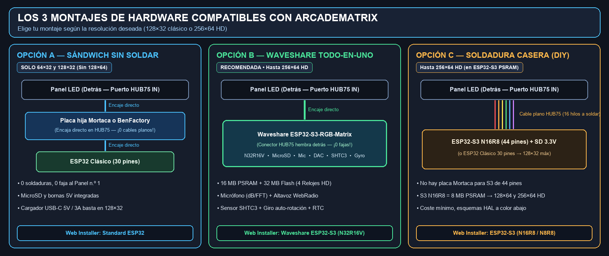
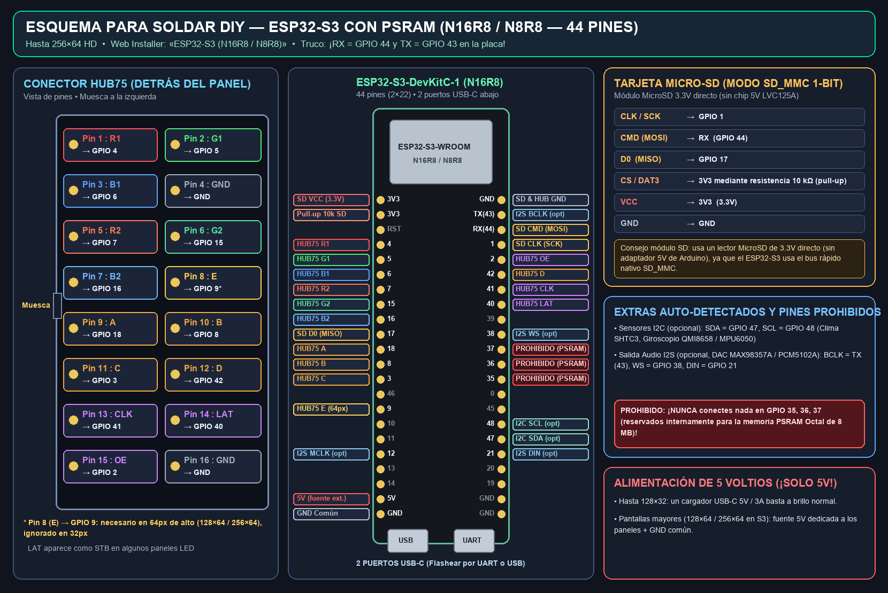
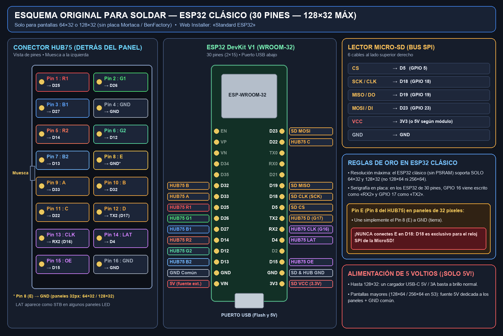
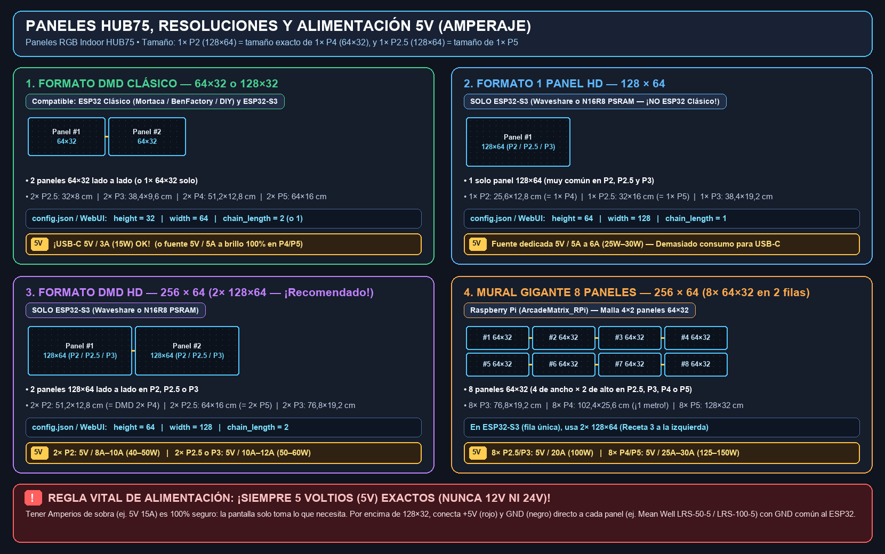

# Guía para Principiantes: Hardware, Conexiones, Paneles y Alimentación

🇬🇧 [English](BEGINNER_GUIDE.md) | 🇫🇷 [Français](BEGINNER_GUIDE_FR.md) | 🇪🇸 Español

Esta guía breve y sin tecnicismos va directo al grano: elegir tu placa electrónica, los paneles **`HUB75`** adecuados, calcular el amperaje de tu fuente de **`5V`** y arrancar **ArcadeMatrix** en minutos.

---

## 1. ¿Cómo funciona ArcadeMatrix? (En 4 pasos rápidos)

La pantalla es **100 % autónoma** (no necesita quedar conectada a ningún PC):
1. **Preparar la MicroSD (`FAT32`)**: descomprime **[`ArcadeMatrix-sdcard.zip`](https://github.com/red77290/ArcadeMatrix/releases/latest)** en la raíz de la tarjeta SD y **abre `config.json` con el Bloc de notas / TextEdit para escribir el `ssid` y `password` de tu Wi-Fi 2.4 GHz** *(obligatorio: ¡el Wi-Fi no se puede configurar desde la pantalla LED!)*.
2. **Flashear en 1 clic (una sola vez)**: conecta el ESP32 por USB al PC/Mac, abre **[red77290.github.io/ArcadeMatrix](https://red77290.github.io/ArcadeMatrix/)** en Chrome o Edge y pulsa **Install**.
3. **Conectar al panel LED y alimentar a `5V`**: al encenderse, el DMD se conecta solo a tu Wi-Fi y muestra su dirección IP.
4. **Controlar desde el móvil o PC**: abre **`http://arcadematrix.local`** (o la IP mostrada) en el navegador para cambiar relojes retro, clima/bolsa, subir GIFs o enlazar **Recalbox / Batocera**.

---

## 2. Elegir y conectar la placa electrónica (3 opciones)



### Opción A — ESP32 Clásico + Placa hija Mortaca o BenFactory *(Sin soldar — `128×32` máx)*
- **Montaje sándwich sin cable plano**: la placa hija se encaja **directamente en el conector `HUB75 IN` detrás del Panel n.º 1** (cero fajas), y un **ESP32 de 30 pines** (`WROOM-32`, 15 pines por lado) se encaja encima. Ranura MicroSD y bornas `5V` ya integradas.
- ⚠️ **Límite**: sin PSRAM, el ESP32 clásico soporta **únicamente `64×32` y `128×32`** *(no admite `128×64` ni `256×64`)*.
- 🔗 **Dónde comprar**: **[Placa Mortaca (DMDos)](https://www.mortaca.com/)** ([dmdos.net](https://www.dmdos.net/)) o **[Placa BenFactory](https://benfactory.fr/categorie-produit/carte-arcade/)** + un `ESP32 DevKit V1 30 pines`.
- **Botón Web Installer**: **`Standard ESP32`**.

### Opción B — Placa todo-en-uno Waveshare `ESP32-S3-RGB-Matrix` *(Sin soldar — Hasta `256×64` HD — Recomendada)*
- **Encaje directo**: trae conector hembra `HUB75` y lector MicroSD soldados detrás — **se encaja directamente detrás del primer panel LED**, sin faja ni soldaduras.
- **Funciones extra que añade**:
  - Pantallas **`128×64` y `256×64` HD** (16 MB PSRAM + 32 MB Flash), además de `64×32` / `128×32`.
  - Los **4 relojes HD exclusivos** (*Metal Slug*, *Pokédex*, *World Clock*, *Words Clock*).
  - **Doble micrófono integrado** (medidor de decibelios + visualizador musical) y **conector de altavoz** (WebRadio autónoma).
  - **Sensor interior `SHTC3`** (temperatura/humedad), **giroscopio `QMI8658`** (rotación auto horizontal/vertical *TATE*), **reloj RTC** y vídeo Showcase en RAM sin desgastar la SD.
- 🔗 **Enlaces oficiales**: **[Tienda Waveshare ESP32-S3-RGB-Matrix](https://www.waveshare.com/esp32-s3-rgb-matrix.htm)** | **[Wiki Waveshare](https://docs.waveshare.com/ESP32-S3-RGB-Matrix)**.
- **Botón Web Installer**: **`Waveshare ESP32-S3 (N32R16V)`**.

### Opción C — Montaje casero soldado (DIY)
No existen placas Mortaca / BenFactory para los `ESP32-S3` de 44 pines, por lo que los montajes soldados usan un **`ESP32-S3-DevKitC-1 (N16R8 / N8R8)` con PSRAM** para tener **`128×64` / `256×64` HD** y los relojes HD a bajo coste (o un `ESP32 Clásico` de 30 pines para `128×32` máx).

#### C.1 — Esquema DIY Recomendado: `ESP32-S3` con PSRAM (`N16R8` / `N8R8` — 44 pines, hasta `256×64` HD)


- **Material**: `ESP32-S3-DevKitC-1 N16R8` (o `N8R8` — comprueba `R8` = 8 MB PSRAM) + un **lector MicroSD `3.3V` directo** *(sin chip 5V `LVC125A` de Arduino, ya que el S3 usa `SD_MMC 1-bit` rápido)* + resistencia de `10 kΩ` entre `CS` y `3V3`.
- ⛔ **No conectes nunca nada en `GPIO 35`, `36`, `37`** (reservados internamente a la PSRAM). En la placa, `GPIO 44` aparece como **`RX`** y `GPIO 43` como **`TX`**.
- **Botón Web Installer**: **`ESP32-S3 (N16R8 / N8R8)`**.

| HUB75 (Panel) | ESP32-S3 | HUB75 (Panel) | ESP32-S3 | MicroSD 3.3V (`SD_MMC`) | ESP32-S3 |
| :--- | :--- | :--- | :--- | :--- | :--- |
| **Pin 1 (`R1`)** | `GPIO 4` | **Pin 9 (`A`)** | `GPIO 18` | **`CLK / SCK`** | `GPIO 1` |
| **Pin 2 (`G1`)** | `GPIO 5` | **Pin 10 (`B`)** | `GPIO 8` | **`CMD` (`MOSI`)** | `RX` (`GPIO 44`) |
| **Pin 3 (`B1`)** | `GPIO 6` | **Pin 11 (`C`)** | `GPIO 3` | **`D0` (`MISO`)** | `GPIO 17` |
| **Pin 4 (`GND`)** | `GND` | **Pin 12 (`D`)** | `GPIO 42` | **`CS / DAT3`** | `3V3` vía `10 kΩ` |
| **Pin 5 (`R2`)** | `GPIO 7` | **Pin 13 (`CLK`)** | `GPIO 41` | **`VCC` / `GND`** | `3V3` / `GND` |
| **Pin 6 (`G2`)** | `GPIO 15` | **Pin 14 (`LAT`/`STB`)** | `GPIO 40` | *(Opc. I2C SHTC3/Giro)* | `SDA=47`, `SCL=48` |
| **Pin 7 (`B2`)** | `GPIO 16` | **Pin 15 (`OE`)** | `GPIO 2` | *(Opc. Audio I2S DAC)* | `BCLK=TX(43), WS=38, DIN=21` |
| **Pin 8 (`E`)** | `GPIO 9` *(64px)* | **Pin 16 (`GND`)** | `GND` | | |

#### C.2 — Esquema DIY Original: `ESP32 Clásico` (`esp32dev` — 30 pines, `128×32` máx)


- **Límite**: **solo `64×32` y `128×32`**. Une `Pin 8 (E)` a `GND` (**nunca a `D18`**, que es el reloj de la MicroSD). Botón Web Installer: **`Standard ESP32`**.

| HUB75 (Panel) | ESP32 (30p) | HUB75 (Panel) | ESP32 (30p) | MicroSD (`SPI`) | ESP32 (30p) |
| :--- | :--- | :--- | :--- | :--- | :--- |
| **Pin 1 (`R1`)** | `D25` | **Pin 9 (`A`)** | `D33` | **`CS`** | `D5` |
| **Pin 2 (`G1`)** | `D26` | **Pin 10 (`B`)** | `D32` | **`SCK / CLK`** | `D18` |
| **Pin 3 (`B1`)** | `D27` | **Pin 11 (`C`)** | `D22` | **`MISO / DO`** | `D19` |
| **Pin 4 (`GND`)** | `GND` | **Pin 12 (`D`)** | `TX2` (`17`) | **`MOSI / DI`** | `D23` |
| **Pin 5 (`R2`)** | `D14` | **Pin 13 (`CLK`)** | `RX2` (`16`) | **`VCC`** | `3V3` *(o `5V` reg.)* |
| **Pin 6 (`G2`)** | `D12` | **Pin 14 (`LAT`/`STB`)** | `D4` | **`GND`** | `GND` |
| **Pin 7 (`B2`)** | `D13` | **Pin 15 (`OE`)** | `D15` | | |
| **Pin 8 (`E`)** | `GND` | **Pin 16 (`GND`)** | `GND` | | |

---

## 3. Paneles compatibles, Resoluciones y Potencia de Alimentación `5V` (Amperaje)

Compra siempre **paneles LED RGB de interior (`Indoor HUB75` / `HUB75E`)** (evita modelos *Outdoor*). **`P2`, `P2.5`, `P3`, `P4`, `P5`** es la separación en milímetros entre dos LEDs.

> 💡 **Equivalencia de tamaño en paneles `128×64`:**
> - Los paneles **`P2` de `128×64`** (`25,6 × 12,8 cm`) son muy fáciles de encontrar y tienen **exactamente el mismo tamaño físico que un `P4` (`64×32`)**, ¡con 4× más píxeles! Unir **`2× P2 (128×64)`** da un **`256×64` HD** del tamaño exacto de un DMD de pinball (`51,2 × 12,8 cm`).
> - Igualmente, un **`P2.5` de `128×64`** (`32 × 16 cm`) mide **exactamente lo mismo que un `P5` (`64×32`)** (`64 × 16 cm` con 2 paneles).



> [!CAUTION]
> **¡Siempre `5 Voltios (5V)` exactos (nunca `12V` ni `24V`)!** Cuanto mayor es el panel (`P4`/`P5`) y más paneles encadenas, más amperaje (`A`) necesitas. Tener Amperios de sobra es 100 % seguro: la pantalla solo consume lo que necesita.

### Tabla resumen: Paneles, Dimensiones y Amperaje `5V` requerido

| Resolución | Paneles unidos | Tamaño total | Placa necesaria | `config.json` / WebUI | Fuente de `5V` y Amperaje necesario |
| :--- | :--- | :--- | :--- | :--- | :--- |
| **`64 × 32`** | **1× `64×32`** (`P2.5` a `P5`) | `16×8 cm` (`P2.5`) a `32×16 cm` (`P5`) | ESP32 o ESP32-S3 | `height=32`, `width=64`, `chain_length=1` | **¡Cargador USB-C `5V / 2A–3A` OK!** |
| **`128 × 32`** *(DMD Clásico)* | **2× `64×32`** lado a lado (`P2.5`, `P3`, **`P4`**, **`P5`**) | • `2× P2.5`: `32 × 8 cm`<br>• `2× P3`: `38,4 × 9,6 cm`<br>• **`2× P4`: `51,2 × 12,8 cm`** *(DMD pinball)*<br>• **`2× P5`: `64 × 16 cm`** | ESP32 Clásico *(Mortaca / BenFactory / DIY)* o ESP32-S3 | `height=32`, `width=64`, `chain_length=2` | **Cargador USB-C `5V / 3A` (15W) OK** a brillo normal<br>*(Prever `5V / 5A` [25W] si usas brillo al 100 % en `P4`/`P5`)* |
| **`128 × 64`** | **1× `128×64`** (`P2`, `P2.5`, `P3`) | • `1× P2`: `25,6 × 12,8 cm` *(= 1× P4)*<br>• `1× P2.5`: `32 × 16 cm` *(= 1× P5)*<br>• `1× P3`: `38,4 × 19,2 cm` | **SOLO ESP32-S3** *(no `esp32dev`)* | `height=64`, `width=128`, `chain_length=1` | **Fuente dedicada `5V / 5A a 6A`** (`25W–30W`) *(no USB-C)* |
| **`256 × 64` HD** *(2 paneles — Recomendado)* | **2× `128×64`** lado a lado en **`P2`**, **`P2.5`** o **`P3`** | • **`2× P2`: `51,2 × 12,8 cm`** *(= DMD `2× P4`)*<br>• **`2× P2.5`: `64 × 16 cm`** *(= DMD `2× P5`)*<br>• `2× P3`: `76,8 × 19,2 cm` | **SOLO ESP32-S3** *(Waveshare o `N16R8`)* | `height=64`, `width=128`, `chain_length=2` | • **`2× P2`**: **`5V / 8A a 10A`** (`40W–50W`)<br>• **`2× P2.5` o `2× P3`**: **`5V / 10A a 12A`** (`50W–60W`, ej. Mean Well `LRS-50-5` / `LRS-75-5`) |
| **`256 × 64` Mural Gigante** *(8 paneles: 4×2)* | **8× `64×32`** (`P2.5`, `P3`, `P4`, `P5` en 2 filas) | • `8× P3`: `76,8 × 19,2 cm`<br>• **`8× P4`: `102,4 × 25,6 cm`** *(¡1 metro!)*<br>• **`8× P5`: `128 × 32 cm`** | *Raspberry Pi ([ArcadeMatrix_RPi](https://github.com/red77290/ArcadeMatrix_RPi)) — en ESP32-S3 usa `2× 128×64`* | *(Versión RPi con `U-mapper`)* | • **`8× P2.5` / `8× P3`**: **`5V / 20A`** (`100W`, `LRS-100-5`)<br>• **`8× P4` / `8× P5`**: **`5V / 25A a 30A`** (`125W–150W`, `LRS-150-5`) |

**Conexión de la fuente `5V` dedicada:** alimenta cada panel directamente con los cables incluidos (**Rojo = `+5V`**, **Negro = `GND`**), y lleva `+5V` / `GND` a la borna de tu placa (o comparte el `GND` común si alimentas el ESP32 por USB). Detrás de los paneles sigue las flechas `➔`: la placa entra en **`IN`** del Panel 1 y una pequeña faja une **`OUT` (Panel 1) → `IN` (Panel 2)**.

---

## 4. Configurar `config.json` (¡Wi-Fi obligatorio!) y Primer Arranque

> [!IMPORTANT]
> **¡El DMD no puede conectarse al Wi-Fi configurándolo desde la pantalla!** Debes **editar obligatoriamente a mano el archivo `config.json`** en la MicroSD con tu `ssid` y `password` antes de encenderlo.

1. **Prepara la MicroSD (`FAT32`)**: copia el contenido de **[`ArcadeMatrix-sdcard.zip`](https://github.com/red77290/ArcadeMatrix/releases/latest)** directamente en la raíz de la SD (`config.json`, `gifs/`, `fighters_32/`...).
2. **Edita `config.json` en la tarjeta SD** con el *Bloc de notas* (Windows) o *TextEdit* (Mac) para poner tu **Wi-Fi `2.4 GHz`** y el **tamaño de tus paneles**:
   ```json
   "matrix": {
       "width": 64,
       "height": 32,
       "chain_length": 2
   },
   "wifi": {
       "ssid": "NombreDeTuWiFi_2.4GHz",
       "password": "TuPasswordWiFi",
       "hostname": "arcadematrix"
   }
   ```
   *(Ejemplo superior para `128×32` = `2× 64×32`. Para `256×64` con `2× 128×64`, pon `"width": 128, "height": 64, "chain_length": 2`).*
3. **Flashea el firmware en 1 clic** en **[red77290.github.io/ArcadeMatrix](https://red77290.github.io/ArcadeMatrix/)** desde Chrome o Edge (`Standard ESP32`, `ESP32-S3 (N16R8 / N8R8)`, o `Waveshare ESP32-S3 (N32R16V)`).
4. **Inserta la MicroSD y enciende**: el DMD se conectará a tu Wi-Fi y mostrará su IP. Abre **`http://arcadematrix.local`** (o `http://<IP_MOSTRADA>`) en el móvil o PC para manejarlo todo al instante (relojes, clima, subida de GIFs sin sacar la SD, [sincronización con Recalbox / Batocera](../README_ES.md#-sincronizaci%C3%B3n-con-recalbox-batocera-y-retropie--showcase-en-juego-marquesinas-fichas-y-v%C3%ADdeos-gameplay)).

---

## 5. Solución rápida de problemas

- **Colores Rojo / Azul invertidos**: en la Web (**Sistema → Hardware → Orden de Color RGB**), cambia `RGB` por **`RBG`** (o `BGR`) y guarda.
- **Pantalla en negro con corriente**: comprueba que la placa está conectada en **`IN` (`J1`)** y no en `OUT`, o cambia **Controlador Matriz** a **`FM6124 / FM6126A`**.
- **Parpadeo / líneas fantasma**: activa **Invertir Fase de Reloj (`clkphase`)** o sube **`Latch Blanking`** en **Sistema → Hardware**.
- **No sale puerto USB en Web Installer**: el cable USB es «solo carga»; usa un cable USB de datos real con Chrome o Edge.

💬 ¿Dudas? ¡Únete a la comunidad en **[Telegram ArcadeMatrix](https://t.me/+DrSdAO8UMUViNmE0)**!
