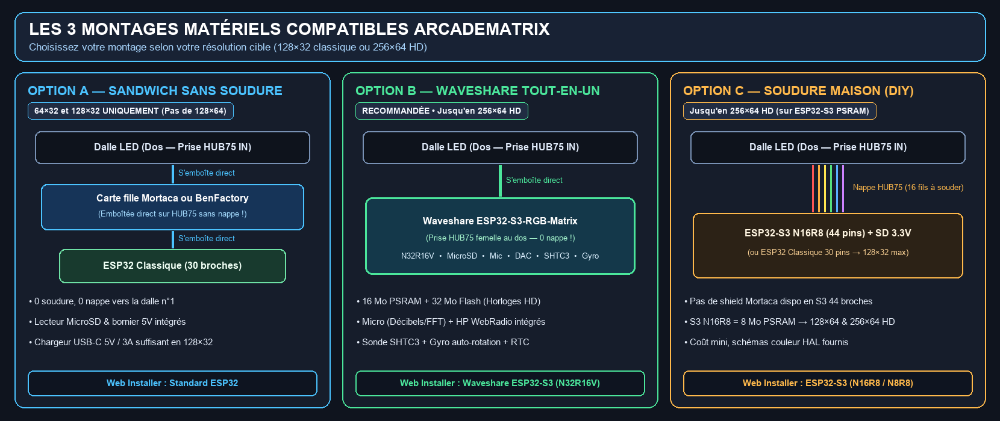
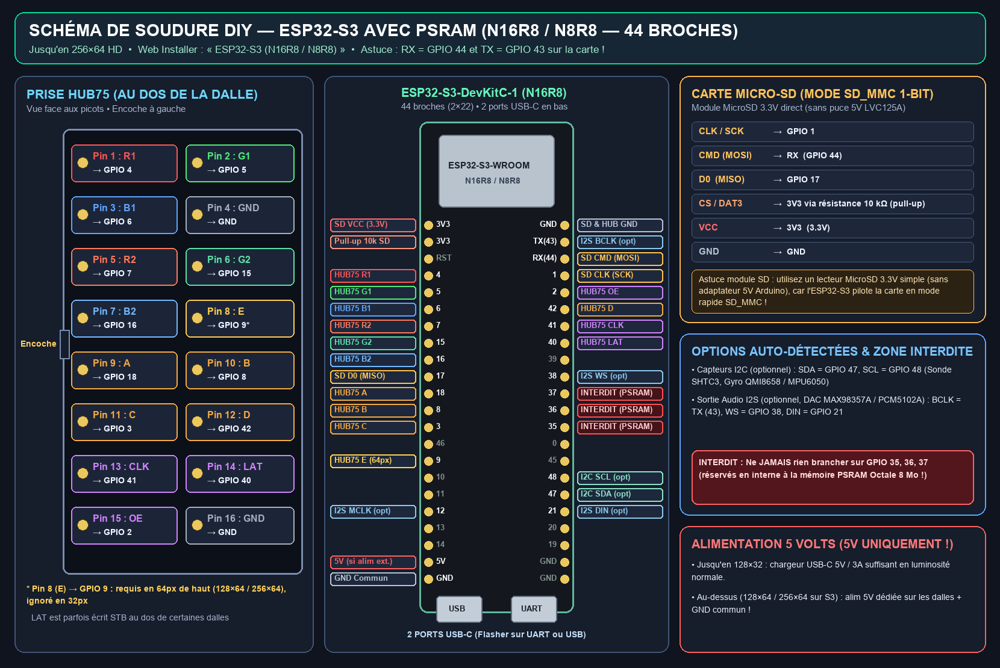
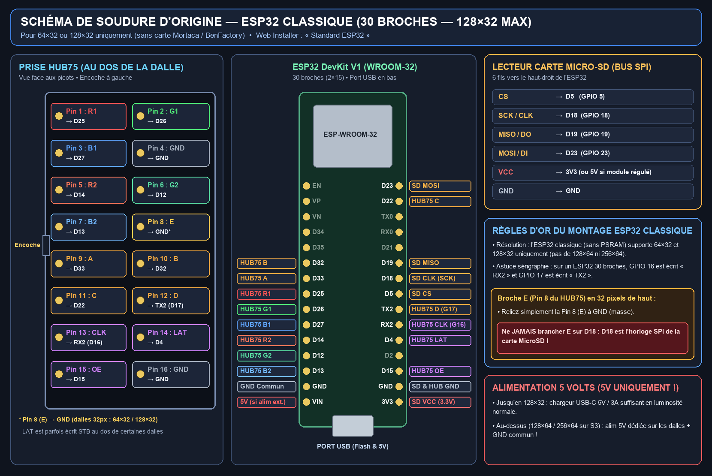
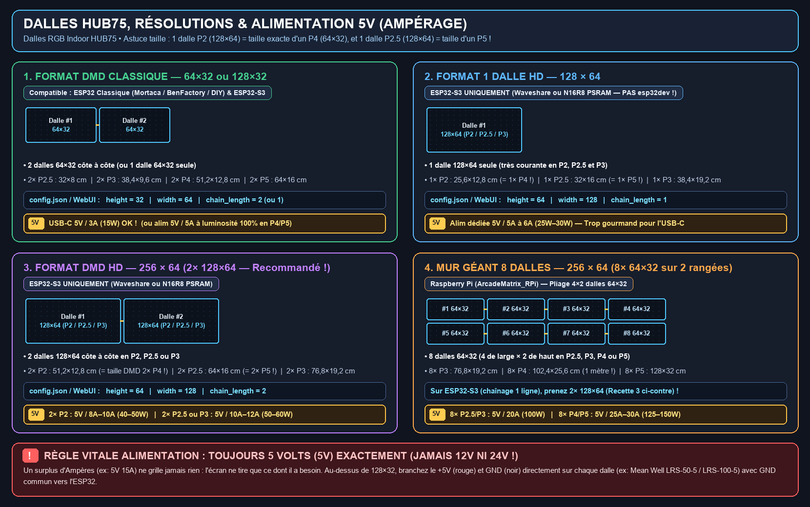

# Guide Débutant : Matériel, Branchements, Dalles & Alimentation

🇬🇧 [English](BEGINNER_GUIDE.md) | 🇫🇷 Français | 🇪🇸 [Español](BEGINNER_GUIDE_ES.md)

Ce guide va droit à l'essentiel, sans jargon technique, pour choisir votre matériel, bien dimensionner votre alimentation **`5V`** et démarrer **ArcadeMatrix** en quelques minutes.

---

## 1. Comment fonctionne ArcadeMatrix ? (En 4 étapes)

L'écran est **100 % autonome** (aucun PC n'a besoin de rester allumé) :
1. **Préparer la carte MicroSD (`FAT32`)** : décompressez **[`ArcadeMatrix-sdcard.zip`](https://github.com/red77290/ArcadeMatrix/releases/latest)** à la racine de la carte SD, puis **ouvrez `config.json` avec le Bloc-notes / TextEdit pour y écrire le nom (`ssid`) et le mot de passe (`password`) de votre Wi-Fi 2.4 GHz** *(obligatoire : le Wi-Fi ne peut pas se saisir depuis l'écran !)*.
2. **Flasher la carte en 1 clic (une seule fois)** : branchez l'ESP32 en USB à votre PC/Mac sur Chrome ou Edge via **[red77290.github.io/ArcadeMatrix](https://red77290.github.io/ArcadeMatrix/)** et cliquez sur **Install**.
3. **Brancher la carte sur la dalle LED et alimenter en `5V`** : au démarrage, l'écran se connecte automatiquement à votre Wi-Fi et affiche son adresse IP.
4. **Piloter depuis votre téléphone ou PC** : ouvrez **`http://arcadematrix.local`** (ou l'IP affichée) dans votre navigateur pour changer d'horloge rétro, activer la météo/bourse, envoyer vos GIFs ou lier **Recalbox / Batocera**.

---

## 2. Choisir et brancher sa carte électronique (3 options)



### Option A — ESP32 Classique + Carte fille Mortaca ou BenFactory *(Sans soudure — `128×32` max)*
- **Montage sandwich sans nappe** : la carte fille se clipse **directement sur la prise `HUB75 IN` au dos de la dalle n°1** (zéro câble plat), et un **ESP32 30 broches** (`WROOM-32`, 15 pattes par côté) se clipse directement par-dessus. Le lecteur MicroSD et le bornier `5V` sont déjà dessus.
- ⚠️ **Limite** : sans mémoire PSRAM, l'ESP32 classique est compatible **`64×32` et `128×32` uniquement** *(pas de `128×64` ni `256×64`)*.
- 🔗 **Où acheter** : **[Carte Mortaca (DMDos)](https://www.mortaca.com/)** ([dmdos.net](https://www.dmdos.net/)) ou **[Carte BenFactory](https://benfactory.fr/categorie-produit/carte-arcade/)** + un `ESP32 DevKit V1 30 pins`.
- **Bouton Web Installer** : **`Standard ESP32`**.

### Option B — Carte tout-en-un Waveshare `ESP32-S3-RGB-Matrix` *(Sans soudure — Jusqu'en `256×64` HD — Recommandée)*
- **Branchement direct** : elle possède déjà une prise femelle `HUB75` et un lecteur MicroSD soudés au dos — **elle s'emboîte directement derrière la première dalle LED**, sans nappe ni soudure.
- **Ce qu'elle débloque en plus** :
  - Écrans **`128×64` et `256×64` HD** (16 Mo PSRAM + 32 Mo Flash) + `64×32` / `128×32`.
  - Les **4 horloges HD exclusives** (*Metal Slug*, *Pokédex*, *World Clock*, *Words Clock*).
  - **Double micro intégré** (Sonomètre décibels + Visualiseur musical) & **prise haut-parleur** (WebRadio autonome).
  - **Sonde climat `SHTC3`** (température/humidité pièce), **gyroscope `QMI8658`** (rotation auto horizontal/vertical *TATE*), **horloge RTC** et streaming vidéo Showcase en RAM sans user la SD.
- 🔗 **Liens officiels** : **[Boutique Waveshare ESP32-S3-RGB-Matrix](https://www.waveshare.com/esp32-s3-rgb-matrix.htm)** | **[Wiki Waveshare](https://docs.waveshare.com/ESP32-S3-RGB-Matrix)**.
- **Bouton Web Installer** : **`Waveshare ESP32-S3 (N32R16V)`**.

### Option C — Montage maison à souder (DIY)
Il n'existe pas d'adaptateur Mortaca / BenFactory pour les `ESP32-S3` à 44 broches : ceux qui soudent leur propre montage utilisent donc un **`ESP32-S3-DevKitC-1 (N16R8 / N8R8)` avec PSRAM** pour avoir le **`128×64` / `256×64` HD** et les horloges HD à petit prix (ou un `ESP32 Classique` 30 broches limité au `128×32`).

#### C.1 — Schéma DIY Recommandé : `ESP32-S3` avec PSRAM (`N16R8` / `N8R8` — 44 broches, jusqu'à `256×64` HD)


- **Matériel** : `ESP32-S3-DevKitC-1 N16R8` (ou `N8R8`, vérifiez le `R8` = 8 Mo PSRAM) + un **module MicroSD `3.3V` direct** *(sans puce 5V `LVC125A` d'Arduino, car le S3 lit la SD en mode rapide `SD_MMC 1-bit`)* + une résistance `10 kΩ` entre `CS` et `3V3`.
- ⛔ **Ne jamais rien brancher sur `GPIO 35`, `36`, `37`** (réservés en interne à la PSRAM !). Sur le circuit imprimé, `GPIO 44` est marqué **`RX`** et `GPIO 43` est marqué **`TX`**.
- **Bouton Web Installer** : **`ESP32-S3 (N16R8 / N8R8)`**.

| HUB75 (Dalle) | ESP32-S3 | HUB75 (Dalle) | ESP32-S3 | MicroSD 3.3V (`SD_MMC`) | ESP32-S3 |
| :--- | :--- | :--- | :--- | :--- | :--- |
| **Pin 1 (`R1`)** | `GPIO 4` | **Pin 9 (`A`)** | `GPIO 18` | **`CLK / SCK`** | `GPIO 1` |
| **Pin 2 (`G1`)** | `GPIO 5` | **Pin 10 (`B`)** | `GPIO 8` | **`CMD` (`MOSI`)** | `RX` (`GPIO 44`) |
| **Pin 3 (`B1`)** | `GPIO 6` | **Pin 11 (`C`)** | `GPIO 3` | **`D0` (`MISO`)** | `GPIO 17` |
| **Pin 4 (`GND`)** | `GND` | **Pin 12 (`D`)** | `GPIO 42` | **`CS / DAT3`** | `3V3` via `10 kΩ` |
| **Pin 5 (`R2`)** | `GPIO 7` | **Pin 13 (`CLK`)** | `GPIO 41` | **`VCC` / `GND`** | `3V3` / `GND` |
| **Pin 6 (`G2`)** | `GPIO 15` | **Pin 14 (`LAT`/`STB`)** | `GPIO 40` | *(Option I2C SHTC3/Gyro)* | `SDA=47`, `SCL=48` |
| **Pin 7 (`B2`)** | `GPIO 16` | **Pin 15 (`OE`)** | `GPIO 2` | *(Option Audio I2S DAC)* | `BCLK=TX(43), WS=38, DIN=21` |
| **Pin 8 (`E`)** | `GPIO 9` *(64px)* | **Pin 16 (`GND`)** | `GND` | | |

#### C.2 — Schéma DIY d'origine : `ESP32 Classique` (`esp32dev` — 30 broches, `128×32` max)


- **Limite** : **`64×32` et `128×32` uniquement**. Broche `Pin 8 (E)` reliée à `GND` (**jamais sur `D18`** qui sert à la carte SD). Bouton Web Installer : **`Standard ESP32`**.

| HUB75 (Dalle) | ESP32 (30p) | HUB75 (Dalle) | ESP32 (30p) | MicroSD (`SPI`) | ESP32 (30p) |
| :--- | :--- | :--- | :--- | :--- | :--- |
| **Pin 1 (`R1`)** | `D25` | **Pin 9 (`A`)** | `D33` | **`CS`** | `D5` |
| **Pin 2 (`G1`)** | `D26` | **Pin 10 (`B`)** | `D32` | **`SCK / CLK`** | `D18` |
| **Pin 3 (`B1`)** | `D27` | **Pin 11 (`C`)** | `D22` | **`MISO / DO`** | `D19` |
| **Pin 4 (`GND`)** | `GND` | **Pin 12 (`D`)** | `TX2` (`17`) | **`MOSI / DI`** | `D23` |
| **Pin 5 (`R2`)** | `D14` | **Pin 13 (`CLK`)** | `RX2` (`16`) | **`VCC`** | `3V3` *(ou `5V` régulé)* |
| **Pin 6 (`G2`)** | `D12` | **Pin 14 (`LAT`/`STB`)** | `D4` | **`GND`** | `GND` |
| **Pin 7 (`B2`)** | `D13` | **Pin 15 (`OE`)** | `D15` | | |
| **Pin 8 (`E`)** | `GND` | **Pin 16 (`GND`)** | `GND` | | |

---

## 3. Dalles compatibles, Résolutions & Puissance d'Alimentation `5V` (Ampérage)

Prenez toujours des **panneaux LED RGB d'intérieur (`Indoor HUB75` / `HUB75E`)** (évitez les modèles *Outdoor*). Le chiffre **`P2`, `P2.5`, `P3`, `P4`, `P5`** est l'écart en millimètres entre deux LEDs.

> 💡 **Astuce taille des dalles `128×64` :**
> - Les dalles **`P2` en `128×64`** (`25,6 × 12,8 cm`) se trouvent très facilement et font **exactement la même taille qu'une dalle `P4` (`64×32`)**, avec 4× plus de pixels ! **`2× P2 (128×64)`** donnent donc un écran **`256×64` HD** à la taille exacte d'un DMD de flipper (`51,2 × 12,8 cm`).
> - De même, une dalle **`P2.5` en `128×64`** (`32 × 16 cm`) fait **exactement la même taille qu'une dalle `P5` (`64×32`)** (`64 × 16 cm` avec 2 dalles) !



> [!CAUTION]
> **Toujours du `5 Volts (5V)` exactement (jamais `12V` ni `24V` !).** Plus une dalle est grande (`P4`/`P5`) et plus vous chaînez de panneaux, plus l'ampérage (`A`) augmente. Prendre une alimentation plus puissante en Ampères ne risque jamais rien : l'écran ne consomme que ce dont il a besoin.

### Tableau récapitulatif : Panneaux, Dimensions & Ampérage `5V` requis

| Résolution | Panneaux assemblés | Taille totale de l'écran | Carte requise | Réglage `config.json` / WebUI | Alimentation `5V` & Ampérage à prévoir |
| :--- | :--- | :--- | :--- | :--- | :--- |
| **`64 × 32`** | **1× `64×32`** (`P2.5` à `P5`) | `16×8 cm` (`P2.5`) à `32×16 cm` (`P5`) | ESP32 ou ESP32-S3 | `height=32`, `width=64`, `chain_length=1` | **Chargeur USB-C `5V / 2A–3A` OK !** |
| **`128 × 32`** *(DMD Classique)* | **2× `64×32`** côte à côte (`P2.5`, `P3`, **`P4`**, **`P5`**) | • `2× P2.5` : `32 × 8 cm`<br>• `2× P3` : `38,4 × 9,6 cm`<br>• **`2× P4` : `51,2 × 12,8 cm`** *(DMD flipper)*<br>• **`2× P5` : `64 × 16 cm`** | ESP32 Classique *(Mortaca / BenFactory / DIY)* ou ESP32-S3 | `height=32`, `width=64`, `chain_length=2` | **Chargeur USB-C `5V / 3A` (15W) OK** en luminosité normale !<br>*(Prévoir `5V / 5A` [25W] si luminosité poussée à 100 % sur `P4`/`P5`)* |
| **`128 × 64`** | **1× `128×64`** (`P2`, `P2.5`, `P3`) | • `1× P2` : `25,6 × 12,8 cm` *(= 1× P4)*<br>• `1× P2.5` : `32 × 16 cm` *(= 1× P5)*<br>• `1× P3` : `38,4 × 19,2 cm` | **ESP32-S3 uniquement** *(pas `esp32dev`)* | `height=64`, `width=128`, `chain_length=1` | **Alim dédiée `5V / 5A à 6A`** (`25W–30W`) *(pas d'USB-C)* |
| **`256 × 64` HD** *(2 dalles — Recommandé)* | **2× `128×64`** côte à côte en **`P2`**, **`P2.5`** ou **`P3`** | • **`2× P2` : `51,2 × 12,8 cm`** *(= DMD `2× P4`)*<br>• **`2× P2.5` : `64 × 16 cm`** *(= DMD `2× P5`)*<br>• `2× P3` : `76,8 × 19,2 cm` | **ESP32-S3 uniquement** *(Waveshare ou `N16R8`)* | `height=64`, `width=128`, `chain_length=2` | • **`2× P2`** : **`5V / 8A à 10A`** (`40W–50W`)<br>• **`2× P2.5` ou `2× P3`** : **`5V / 10A à 12A`** (`50W–60W`, ex: Mean Well `LRS-50-5` / `LRS-75-5`) |
| **`256 × 64` Mur Géant** *(8 dalles : 4×2)* | **8× `64×32`** (`P2.5`, `P3`, `P4`, `P5` sur 2 étages) | • `8× P3` : `76,8 × 19,2 cm`<br>• **`8× P4` : `102,4 × 25,6 cm`** *(1 mètre !)*<br>• **`8× P5` : `128 × 32 cm`** | *Raspberry Pi ([ArcadeMatrix_RPi](https://github.com/red77290/ArcadeMatrix_RPi)) — sur ESP32-S3 prenez `2× 128×64`* | *(Version RPi avec `U-mapper`)* | • **`8× P2.5` / `8× P3`** : **`5V / 20A`** (`100W`, `LRS-100-5`)<br>• **`8× P4` / `8× P5`** : **`5V / 25A à 30A`** (`125W–150W`, `LRS-150-5`) |

**Branchement de l'alimentation `5V` dédiée :** reliez directement chaque dalle à l'alimentation avec les câbles fournis (**Rouge = `+5V`**, **Noir = `GND`**), et reliez aussi le `+5V` / `GND` au bornier de votre carte (ou gardez le `GND` commun si l'ESP32 est alimenté en USB). Au dos des dalles, suivez les flèches `➔` : la carte va sur **`IN`** de la dalle n°1, puis une petite nappe relie **`OUT` (dalle 1) → `IN` (dalle 2)**.

---

## 4. Configuration `config.json` (Wi-Fi obligatoire !) & Première mise en route

> [!IMPORTANT]
> **Le DMD ne peut pas configurer le Wi-Fi depuis l'écran !** Vous devez **impérativement modifier à la main le fichier `config.json`** sur votre carte MicroSD avant le premier allumage.

1. **Préparez la MicroSD (`FAT32`)** : copiez le contenu de **[`ArcadeMatrix-sdcard.zip`](https://github.com/red77290/ArcadeMatrix/releases/latest)** directement à la racine de la carte SD (`config.json`, `gifs/`, `fighters_32/`...).
2. **Modifiez `config.json` sur la carte SD** avec le *Bloc-notes* (Windows) ou *TextEdit* (Mac) pour renseigner votre **Wi-Fi `2.4 GHz`** et la **taille de vos dalles** :
   ```json
   "matrix": {
       "width": 64,
       "height": 32,
       "chain_length": 2
   },
   "wifi": {
       "ssid": "NomDeVotreBox_2.4GHz",
       "password": "VotreMotDePasseWiFi",
       "hostname": "arcadematrix"
   }
   ```
   *(Exemple ci-dessus pour un `128×32` = `2× 64×32`. Pour un `256×64` en `2× 128×64`, mettez `"width": 128, "height": 64, "chain_length": 2`).*
3. **Flashez le firmware en 1 clic** sur **[red77290.github.io/ArcadeMatrix](https://red77290.github.io/ArcadeMatrix/)** depuis Chrome ou Edge (`Standard ESP32`, `ESP32-S3 (N16R8 / N8R8)`, ou `Waveshare ESP32-S3 (N32R16V)`).
4. **Insérez la carte MicroSD et allumez** : le DMD se connecte à votre Wi-Fi et affiche son IP. Ouvrez **`http://arcadematrix.local`** (ou `http://<IP_AFFICHEE>`) sur votre téléphone ou PC pour tout contrôler en direct (horloges, météo, envoi de GIFs sans retirer la SD, [synchronisation Recalbox / Batocera](../README_FR.md#-synchronisation-recalbox-batocera--retropie--showcase-en-jeu-marquees-fiches--vidéos-gameplay)).

---

## 5. Dépannage express

- **Couleurs Rouge / Bleu inversées** : dans l'interface Web (**Système → Matériel → Ordre des Couleurs RGB**), passez `RGB` en **`RBG`** (ou `BGR`) et enregistrez.
- **Écran noir malgré l'alimentation** : vérifiez que la carte est bien sur **`IN` (`J1`)** et non `OUT`, ou passez **Contrôleur Matrice** sur **`FM6124 / FM6126A`**.
- **Scintillement / lignes baveuses** : activez **Inverser la Phase d'Horloge (`clkphase`)** ou montez **`Latch Blanking`** dans **Système → Matériel**.
- **Aucun port USB dans le Web Installer** : votre câble USB est un câble « charge seule » — prenez un vrai câble USB de données avec Chrome ou Edge.

💬 Une question ? Rejoignez la communauté sur **[Telegram ArcadeMatrix](https://t.me/+DrSdAO8UMUViNmE0)** !
