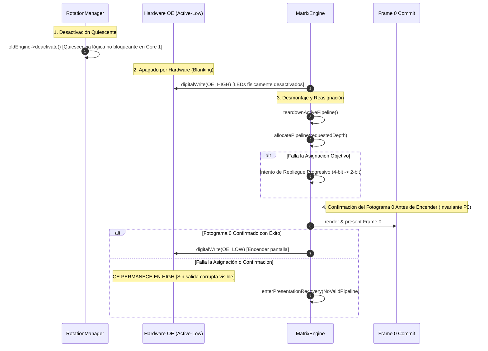

# Modelo de Memoria y Arquitectura de Presentación ArcadeMatrix V4

> **Especificación Normativa**  
> **Estado:** Arquitectura Central  
> **Plataformas Objetivo:** ESP32 Estándar (`esp32dev`) y ESP32-S3 (`esp32s3_waveshare`)

---

## 1. Filosofía Arquitectónica y Dominios de Memoria

ArcadeMatrix gestiona la memoria de forma dinámica según sus atributos de hardware en ESP-IDF:

```
┌────────────────────────────────────────────────────────────────────────┐
│                        Memoria Física ESP32                            │
├──────────────────────────────────────────┬─────────────────────────────┤
│         SRAM Interna (320–512 KB)        │   PSRAM Externa (8 MB)      │
│                                          │  (Solo Destinos ESP32-S3)   │
├────────────────────┬─────────────────────┼─────────────────────────────┤
│ Heap General       │ SRAM Compatible DMA │ Cachés de Activos Grandes   │
│ MALLOC_CAP_8BIT    │ MALLOC_CAP_DMA      │ MALLOC_CAP_SPIRAM           │
│                    │                     │                             │
│ • Pilas FreeRTOS   │ • Bitplanes HUB75   │ • Fotogramas GIF Predecod.  │
│ • Estructuras Core │ • Buffers Audio I2S │ • Búferes Audio PCM         │
│ • Reg. mbedTLS     │ • DMA Maestro SPI   │ • Cachés de Glifos Fuente   │
└────────────────────┴─────────────────────┴─────────────────────────────┘
```

* **DRAM Interna General (`MALLOC_CAP_8BIT`):** Pilas FreeRTOS, estructuras de estado, buffers mbedTLS.
* **DRAM Interna DMA (`MALLOC_CAP_DMA`):** Bitplanes HUB75, buffers I2S, maestros SPI.
* **PSRAM Externa (`MALLOC_CAP_SPIRAM`):** Caché de fotogramas GIF predecodificados, fuentes, audio PCM.

> [!WARNING]
> **Vistas Filtradas por Capacidades (No Pools Disjuntos):**  
> En arquitecturas ESP32, `MALLOC_CAP_DMA` es un subconjunto de la DRAM interna:
> $$\text{dmaFreeBytes} \subseteq \text{internalFreeBytes}$$
> **Está estrictamente prohibido sumar** `internalFreeBytes + dmaFreeBytes`.

---

## 2. Dimensionamiento Cuantitativo de Memoria DMA HUB75

La fuente de verdad para el dimensionamiento de bitplanes DMA es `Hub75DmaLayout::calculateBytes()`:
$$\text{Bytes DMA} = \left(\frac{\text{Altura}}{2}\right) \times \text{Profundidad} \times (\text{Anchura} \times 2) \times \text{Buffers}$$

### 2.1 Tabla Normativa de Dimensionamiento DMA

| Geometría | Profundidad de Color | Búfer Único (`canvas_single`) | Doble Búfer (`direct_double`) |
| :--- | :---: | :---: | :---: |
| **64 × 32** | 8 bits | 4.096 B | 8.192 B |
| **64 × 32** | 4 bits | **2.048 B** | 4.096 B |
| **128 × 32** | 8 bits | 16.384 B | 32.768 B |
| **128 × 32** | 6 bits | 12.288 B | 24.576 B |
| **128 × 32** | 4 bits | **8.192 B** | 16.384 B |
| **128 × 32** | 2 bits | **4.096 B** | 8.192 B |
| **128 × 64** | 8 bits | 32.768 B | 65.536 B |
| **128 × 64** | 4 bits | **16.384 B** | 32.768 B |
| **256 × 64** | 8 bits | 65.536 B | 131.072 B |
| **256 × 64** | 4 bits | **32.768 B** | 65.536 B |

---

## 3. Profundidad Dinámica Determinista ($8 \leftrightarrow 4$)

```
[Motor Gráfico: Clock, GIF, Marquee] ───(Rotación)───► [Motor de Red TLS: Crypto, Stock, Weather]
         Profundidad = 8 bits (Configurada)                    Profundidad = 4 bits (Nominal TLS)
         DMA = 16.384 B (128x32)                               DMA = 8.192 B (128x32)
         DRAM Contigua = Amplia                                Recupera +8.192 B para mbedTLS
```

### 3.1 Conceptos y Semántica de Profundidad
* **`configuredDepth`:** Ajuste del usuario configurado mediante `/api/settings` (por defecto 8 bits).
* **`requestedDepth`:** Decisión determinista de rotación según necesidades TLS:
  $$\text{requestedDepth} = (\text{targetNeedsTls} \land \text{dynamicColorDepth}) \;?\; \min(\text{configuredDepth}, 4) \;:\; \text{configuredDepth}$$
* **`effectiveDepth`:** Profundidad física real asignada en el controlador.
* **`fallbackUsed`:** Indicador estricto de telemetría:
  $$\text{fallbackUsed} = (\text{effectiveDepth} \neq \text{requestedDepth})$$

---

## 4. Transacción de Presentación de Hardware (Invariante 21)

Cada reconfiguración del pipeline se ejecuta bajo **apagado físico por hardware Output Enable (OE)** para asegurar que ningún fallo óptico, desgarro o línea corrupta llegue al panel físico:



### 4.1 Invariante Formal P0
`digitalWrite(OE, LOW)` está estrictamente prohibido hasta que:
1. Se asigne la memoria DMA física.
2. Se reconstruyan las tablas LUT de color (`FastMatrixPanel::initLuts(effectiveDepth)`).
3. Se renderice y confirme el fotograma 0 (`firstFrameCommitted == true`).

Si la asignación falla, `OE` permanece en `HIGH` (`PresentationRecovery`) para evitar cualquier artefacto óptico.

---

## 5. Puntuación de Salud de Memoria y Métricas de Dominio

El `MemoryManager` calcula métricas empíricas por dominio:
- **Ratio de Fragmentación por Dominio:**
  $$\text{fragmentationPct} = 100 - \left( \frac{\text{largestBlock} \times 100}{\text{freeBytes}} \right)$$
- **Puntuación de Salud de Memoria ($0 \dots 100$):**
  $$\text{Score} = 0.4 \times \min\left(100, \frac{\text{freeInternal}}{60\,\text{KB}} \times 100\right) + 0.4 \times \min\left(100, \frac{\text{largestBlock}}{35\,\text{KB}} \times 100\right) + 0.2 \times (100 - \text{fragmentationPct})$$

