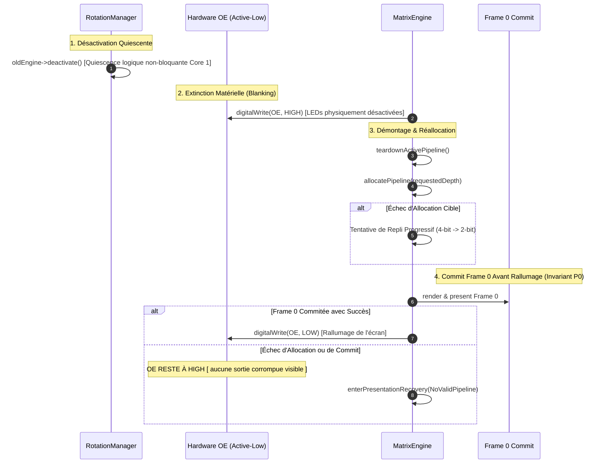

# Modèle Mémoire & Architecture de Présentation ArcadeMatrix V4

> **Spécification d'Autorité**  
> **Statut :** Architecture Normative  
> **Cibles :** ESP32 Standard (`esp32dev`) & ESP32-S3 (`esp32s3_waveshare`)

---

## 1. Philosophie Architecturale & Domaines de Mémoire

ArcadeMatrix traite la mémoire comme une ressource dynamique et graduée par capacités. Les allocations ESP-IDF dépendent des attributs matériels :

```
┌────────────────────────────────────────────────────────────────────────┐
│                        Mémoire Physique ESP32                          │
├──────────────────────────────────────────┬─────────────────────────────┤
│         SRAM Interne (320–512 Ko)        │   PSRAM Externe (8 Mo)      │
│                                          │  (Cibles ESP32-S3 Uniq.)    │
├────────────────────┬─────────────────────┼─────────────────────────────┤
│ Tas Général        │ SRAM Compatible DMA │ Caches d'Assets Volumineux  │
│ MALLOC_CAP_8BIT    │ MALLOC_CAP_DMA      │ MALLOC_CAP_SPIRAM           │
│                    │                     │                             │
│ • Piles FreeRTOS   │ • Bitplanes HUB75   │ • Trames GIF Pré-décodées   │
│ • Structures Core  │ • Buffers Audio I2S │ • Tampons Audio PCM         │
│ • Enreg. mbedTLS   │ • DMA Maître SPI    │ • Caches de Glyphes Police  │
└────────────────────┴─────────────────────┴─────────────────────────────┘
```

* **DRAM Interne Générale (`MALLOC_CAP_8BIT`) :** Piles FreeRTOS, structures d'état, buffers de négociation mbedTLS.
* **DRAM Interne DMA (`MALLOC_CAP_DMA`) :** Bitplanes HUB75, buffers I2S audio, maîtres SPI.
* **PSRAM Externe (`MALLOC_CAP_SPIRAM`) :** Caches de trames GIF pré-décodées, tampons audio PCM, caches de glyphes.

> [!WARNING]
> **Vues Filtrées par Capacités (Pas de Pools Disjoints) :**  
> Sur ESP32, `MALLOC_CAP_DMA` est un attribut satisfait par un sous-ensemble de la DRAM interne :
> $$\text{dmaFreeBytes} \subseteq \text{internalFreeBytes}$$
> Il est **strictement interdit d'additionner** `internalFreeBytes + dmaFreeBytes`.

---

## 2. Empreinte Mémoire DMA HUB75

L'autorité de calcul est `Hub75DmaLayout::calculateBytes()` :
$$\text{Octets DMA} = \left(\frac{\text{Hauteur}}{2}\right) \times \text{Profondeur} \times (\text{Largeur} \times 2) \times \text{Buffers}$$

| Géométrie | Profondeur | Buffer Unique (`canvas_single`) | Double Buffer (`direct_double`) |
| :--- | :---: | :---: | :---: |
| **64 × 32** | 8 bits | 4 096 o | 8 192 o |
| **64 × 32** | 4 bits | **2 048 o** | 4 096 o |
| **128 × 32** | 8 bits | 16 384 o | 32 768 o |
| **128 × 32** | 6 bits | 12 288 o | 24 576 o |
| **128 × 32** | 4 bits | **8 192 o** | 16 384 o |
| **128 × 32** | 2 bits | **4 096 o** | 8 192 o |
| **128 × 64** | 8 bits | 32 768 o | 65 536 o |
| **128 × 64** | 4 bits | **16 384 o** | 32 768 o |
| **256 × 64** | 8 bits | 65 536 o | 131 072 o |
| **256 × 64** | 4 bits | **32 768 o** | 65 536 o |

---

## 3. Profondeur Dynamique Déterministe ($8 \leftrightarrow 4$)

```
[Moteur Graphique : Clock, GIF, Marquee] ───(Rotation)───► [Moteur Réseau TLS : Crypto, Stock, Weather]
         Profondeur = 8 bits (Configurée)                            Profondeur = 4 bits (Nominal TLS)
         DMA = 16 384 o (128x32)                                     DMA = 8 192 o (128x32)
         DRAM Contiguë = Ample                                       Libère +8 192 o pour mbedTLS
```

### 3.1 Concepts & Sémantique de Profondeur
* **`configuredDepth` :** Choix utilisateur configuré via `/api/settings` (8 bits par défaut).
* **`requestedDepth` :** Décision déterministe de rotation :
  $$\text{requestedDepth} = (\text{targetNeedsTls} \land \text{dynamicColorDepth}) \;?\; \min(\text{configuredDepth}, 4) \;:\; \text{configuredDepth}$$
* **`effectiveDepth` :** Profondeur physique réellement allouée dans le contrôleur.
* **`fallbackUsed` :** Indicateur strict de télémétrie :
  $$\text{fallbackUsed} = (\text{effectiveDepth} \neq \text{requestedDepth})$$

---

## 4. Transaction de Présentation Matérielle (Invariant 21)

Chaque reconfiguration du pipeline s'exécute sous **extinction matérielle Output Enable (OE)** afin qu'aucun glitch optique, déchirement ou ligne de balayage corrompue n'atteigne l'écran physique :



### 4.1 Invariant Formel P0
L'appel `digitalWrite(OE, LOW)` est strictement interdit jusqu'à ce que :
1. La mémoire DMA physique soit allouée.
2. Les tables de couleurs (LUT) soient régénérées (`FastMatrixPanel::initLuts(effectiveDepth)`).
3. La Frame 0 soit rendue et commitée avec succès dans le contrôleur (`firstFrameCommitted == true`).

En cas d'échec catastrophique, `OE` reste à `HIGH` (`PresentationRecovery`) afin d'empêcher tout artefact visuel.

---

## 5. Score de Santé Mémoire & Métriques de Domaine

Le `MemoryManager` calcule des métriques empiriques par domaine :
- **Ratio de Fragmentation par Domaine :**
  $$\text{fragmentationPct} = 100 - \left( \frac{\text{largestBlock} \times 100}{\text{freeBytes}} \right)$$
- **Score de Santé Mémoire ($0 \dots 100$) :**
  $$\text{Score} = 0.4 \times \min\left(100, \frac{\text{freeInternal}}{60\,\text{Ko}} \times 100\right) + 0.4 \times \min\left(100, \frac{\text{largestBlock}}{35\,\text{Ko}} \times 100\right) + 0.2 \times (100 - \text{fragmentationPct})$$

